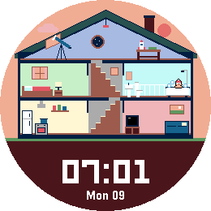
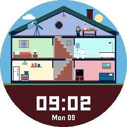
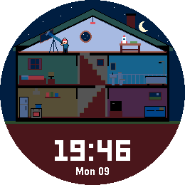
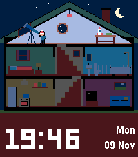

# House on a Pebble

*A tiny housemate lives in a cross-section house on your wrist and wanders to another room as time goes by.*

   

A Pebble watchface (v1.0.0) for Pebble Time 2 (emery) and Pebble Round 2 (gabbro).

## What it does

The house shows a daily routine rather than a random animation:

| Time | Your housemate |
|---|---|
| 23:00-07:00 | sleeps, lights out |
| 07:00-08:30 | takes a bath, cooks breakfast |
| 08:30-12:00 | works on a model rocket, reads, looks through the telescope |
| 12:00-13:30 | cooks, sits on the sofa |
| 13:30-18:00 | works on the rocket, watches TV, reads, looks through the telescope |
| 18:00-19:30 | cooks, sits on the sofa |
| 19:30-22:30 | watches TV, looks through the telescope, reads |
| 22:30-23:00 | takes a bath, reads |

The sky follows fixed times: dawn from 06:30, day from 07:30, dusk from 17:30, night from 19:00. At night only the room your housemate is in stays lit.

The animation runs only during a walk and for about four seconds after arriving, opening the face or flicking your wrist. The rest of the time the face redraws once a minute.

## Settings

- **Moves to another room** - every minute, 5 minutes, 15 minutes or every hour. More frequent walks use a little more battery. At night your housemate stays in bed whatever you choose here.
- **Vibrate before walking** - off by default. A short buzz three seconds before your housemate sets off, so you can watch. Stays silent during Quiet Time, at bedtime and when getting up.

Flick your wrist to see what your housemate is up to: the current activity plays for a few seconds.

## Artwork

All artwork is generated by `tools/gen_art.py` (requires Pillow). The house geometry there must match the `#define`s in `src/c/houseonapebble.c`.

## Building

Requires the [Pebble SDK](https://developer.repebble.com/sdk/).

```bash
pebble build
pebble install --emulator gabbro
```

## Release notes

### 1.0.0

First release.

## Status

Version 1.0.0 is finished and tested in the emulator on emery and gabbro: routine, walks, all seven activities, day/dusk/night, wrist flick, 12-hour display and the delay before a walk. Store screenshots come from `screenshots/presets.json`, which sets the emulator clock for each shot.

Open points: not tested on real hardware, so the buzz, Quiet Time, the Clay page in a browser and battery use are unverified. Bedtimes and day/night times are fixed rather than following season or location.
